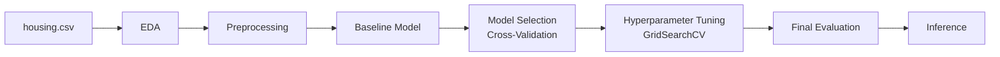

# 🏠 House Price Prediction

A machine learning project that predicts median house values in California districts using the **California Housing Prices** dataset.

**Dataset:** [California Housing Prices (Kaggle)](https://www.kaggle.com/datasets/camnugent/california-housing-prices) — `housing.csv`

---

## Pipeline Overview



| Stage | Description | Status |
|-------|-------------|--------|
| 1. Setup | Dependencies, configuration, reproducibility (`RANDOM_STATE = 42`) | ✅ Done |
| 2. Data loading | Load `housing.csv` into a pandas DataFrame | ✅ Done |
| 3. EDA | Structure, data types, missing values, duplicates, descriptive statistics | 🚧 In progress |
| 4. Preprocessing | Imputation, scaling, one-hot encoding via `Pipeline` + `ColumnTransformer` | ⏳ Planned |
| 5. Baseline model | Simple reference model to beat | ⏳ Planned |
| 6. Model selection | K-Fold cross-validation across several regressors | ⏳ Planned |
| 7. Tuning | `GridSearchCV` on the best candidate | ⏳ Planned |
| 8. Final evaluation | MAE, RMSE, R² on the held-out test set | ⏳ Planned |
| 9. Inference | Predict prices for new data | ⏳ Planned |

---

## Dataset

Each row describes a **block group** (district) in California.

| Column | Description |
|--------|-------------|
| `longitude` | How far west a block is (higher = farther west) |
| `latitude` | How far north a block is (higher = farther north) |
| `housing_median_age` | Median age of houses in the block (lower = newer) |
| `total_rooms` | Total number of rooms in the block |
| `total_bedrooms` | Total number of bedrooms in the block |
| `population` | Number of people residing in the block |
| `households` | Number of households in the block |
| `median_income` | Median household income (in tens of thousands of USD) |
| `ocean_proximity` | Location of the block relative to the ocean (categorical) |
| **`median_house_value`** | **Target:** median house value (in USD) |

**Data quality notes (so far):**
- `total_bedrooms` contains missing values → will be imputed in the preprocessing step.
- `ocean_proximity` is the only categorical feature → will be one-hot encoded.

---

## Tech Stack

- Python 3.12
- NumPy, pandas
- Matplotlib, seaborn
- scikit-learn (`Pipeline`, `ColumnTransformer`, `GridSearchCV`, `LinearRegression`, `Ridge`, `Lasso`, `RandomForestRegressor`, `HistGradientBoostingRegressor`)

---

## Project Structure

```
House-Price-Prediction/
├── house_price_prediction.ipynb   # main notebook
├── housing.csv                    # dataset (download from Kaggle)
├── requirements.txt
├── .gitignore
└── README.md
```

---

## Installation

```bash
# 1. Clone the repository
git clone https://github.com/<your-username>/House-Price-Prediction.git
cd House-Price-Prediction

# 2. Create and activate a virtual environment
python -m venv .venv
source .venv/bin/activate        # Windows: .venv\Scripts\activate

# 3. Install dependencies
pip install -r requirements.txt
```

`requirements.txt`:

```
numpy
pandas
matplotlib
seaborn
scikit-learn
jupyter
```

> **Dataset:** download `housing.csv` from [Kaggle](https://www.kaggle.com/datasets/camnugent/california-housing-prices) and place it in the project root (or update `CSV_PATH` in the

